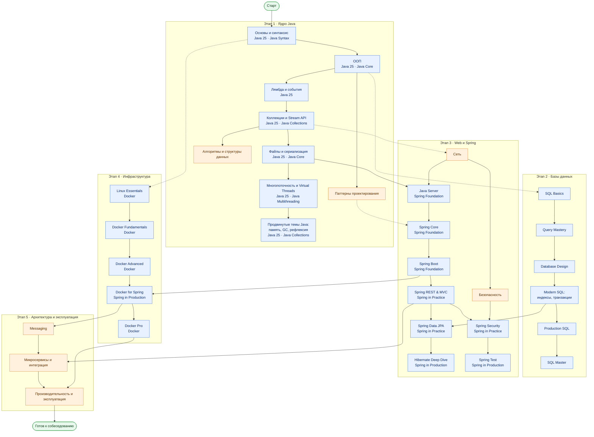

# Java RoadMap — модули

Черновик верхнеуровневого RoadMap Java-домена. Не коммитить.
Основа — модули курсов JavaRush (см. `plans/javarush-courses.md`) плюс собственные
модули под темы приложения, которых в курсах нет.

Ветки без выхода (Алгоритмы, SQL Master, Hibernate Deep Dive, Spring Test,
Продвинутые темы Java) — самостоятельные «концевые» модули: их проходят в любой
момент после входа и до собеседования, дальше по пути они ничего не открывают.

Легенда: синие — модули JavaRush (под названием — курс), оранжевые — собственные
модули; сплошная стрелка — «нужно пройти до», пунктир — «желательно до / можно
параллельно».

## Решения

**Курс Java и Курс Java 25 объединены.** Это два варианта одного пути, и в
RoadMap их модули дублировали бы друг друга. Скелет взят из Java 25: семь
модулей нарезаны по темам. Модули классического курса смешанные (в Java
Collections есть и GC, и паттерны, и REST), поэтому они указаны там, где
лежит их основная часть, а уровни разойдутся по модулям при раскладке тем.

**Лямбды стоят до коллекций.** В Java 25 модуль «Лямбда и события» идёт после
Stream API, но для Stream API лямбды нужны заранее, поэтому порядок изменён.

**Паттерны проектирования — отдельный модуль, сразу после ООП.** Если их
рассредоточить, `design-patterns-overview` и сравнения (`strategy-vs-state`,
`factory-method-vs-abstract-factory`, `decorator-vs-proxy`) не к чему привязать:
они сравнивают паттерны между собой, а не объясняют модуль. К тому же
структурные (practice) темы приложения — почти все паттерны, это единый блок
практики. JavaRush тоже даёт паттерны одним уровнем. Там, где паттерн —
механизм фреймворка, модуль только знакомит с ним, а применение остаётся в
своём модуле и ссылается назад:

- Proxy → Spring Core (`spring-aop-proxy`, `jdk-dynamic-proxy-vs-cglib`);
- Chain of Responsibility → Spring Security (filter chain);
- Observer → Spring Core (Application Events).

Архитектурные паттерны в этот модуль не входят: `microservice-patterns`,
`outbox-pattern`, `inbox-pattern` — в «Микросервисы и интеграция»,
`presentation-patterns-beyond-mvc` — в Spring REST & MVC.

`singleton-thread-safe` в этот модуль не входит: тема держится на `volatile` и
double-checked locking, поэтому она стоит в конце «Многопоточности».

**`spring-async-self-invocation` — в Spring Core**, рядом с
`spring-aop-limitations` (уровень «Proxy-модель Spring без мистики»): это
ограничение прокси, показанное на `@Async`. Отдельный модуль не нужен. Темы про
самовызов с `@Transactional` стоят в Spring Data JPA, потому что они требуют
знания транзакций.

**Безопасность разделена на два модуля.** Собственная «Безопасность» — общие
понятия, не зависящие от Spring (OWASP, XSS, инъекции, шифрование, TLS, OAuth/OIDC,
схема аутентификации). Spring Security — их реализация (CSRF, CORS, сессии
против JWT, защита эндпоинтов). Поэтому «Безопасность» идёт до Spring Security.

## Раскладка тем по модулям

350 вопросов Java-домена: 216 готовых тем и 134 запланированных (помечены **план**, теории пока нет; из них 7 дополнительных ◇). Порядок внутри модуля — порядок изучения. Источник порядка — `frontend/src/roadmap.json`. Темы других доменов (`ndm`, `qa`) сюда не входят.

| Модуль | Готово | План |
|---|---:|---:|
| Основы и синтаксис | 13 | 6 |
| ООП | 12 | 7 |
| Паттерны проектирования | 10 | 0 |
| Лямбда и события | 1 | 3 |
| Коллекции и Stream API | 15 | 8 |
| Алгоритмы и структуры данных | 12 | 5 |
| Файлы и сериализация | 1 | 6 |
| Многопоточность и Virtual Threads | 22 | 7 |
| Продвинутые темы Java: память, GC, рефлексия | 14 | 3 |
| SQL Basics | 3 | 3 |
| Query Mastery | 0 | 4 |
| Database Design | 5 | 2 |
| Modern SQL | 7 | 2 |
| Production SQL | 9 | 4 |
| SQL Master | 0 | 2 |
| Сеть | 9 | 4 |
| Java Server | 1 | 5 |
| Spring Core | 15 | 5 |
| Spring Boot | 3 | 5 |
| Spring REST & MVC | 9 | 6 |
| Spring Data JPA | 8 | 7 |
| Hibernate Deep Dive | 6 | 6 |
| Безопасность | 7 | 1 |
| Spring Security | 5 | 4 |
| Spring Test | 0 | 6 |
| Linux Essentials | 0 | 3 |
| Docker Fundamentals | 0 | 2 |
| Docker Advanced | 0 | 3 |
| Docker for Spring | 1 | 2 |
| Docker Pro | 0 | 1 |
| Messaging | 3 | 3 |
| Микросервисы и интеграция | 16 | 5 |
| Производительность и эксплуатация | 9 | 4 |

### Этап 1 · Ядро Java

#### Основы и синтаксис (19)

1. `jvm-source-code-flow` — Как Java source code становится работающей программой
2. **план** Какие условные операторы и циклы есть в Java и как выбрать подходящий? (`plan-control-flow`)
3. `java-data-types` — Типы данных в Java и как они работают
4. `java-primitive-sizes` — Размеры примитивных типов в Java
5. **план** Как работает приведение примитивных типов и что такое переполнение? (`plan-primitive-casting`)
6. `primitive-vs-object-types` — Примитивные и объектные типы
7. **план** Что такое autoboxing и какие у него подводные камни? (`plan-autoboxing`)
8. `variable-storage` — Что хранит переменная и где
9. `reference-types-storage` — Где хранятся ссылочные типы
10. **план** Как устроены массивы в Java и что умеет класс Arrays? (`plan-arrays`)
11. `java-static-keyword` — static в Java
12. `final` — Ключевое слово final и где оно встречается
13. **план** Что умеют enum и современный switch? (`plan-enum-switch`)
14. `method-signature` — Что такое сигнатура метода
15. `method-call-stack-frames` — Вызовы методов и кадры стека
16. `string-immutability` — Иммутабельность строк
17. `string-concatenation` — Конкатенация миллиона строк
18. **план** Как работать с датой и временем через java.time и таймзоны? (`plan-java-time`)
19. `exception-basics` — Исключения в Java и их типы

#### ООП (19)

1. **план** Что такое класс и объект, и в каком порядке инициализируется объект? (`plan-class-object-init`)
2. `oop-principles` — Принципы ООП
3. `oop-principles-applied` — Принципы ООП на практике
4. `default-vs-protected` — Доступ default и protected
5. `override-vs-overload` — Переопределение vs перегрузка
6. **план** Как работают приведение ссылочных типов и instanceof? (`plan-reference-casting`)
7. `interface-vs-abstract-class` — Интерфейс vs абстрактный класс
8. **план** Когда композиция лучше наследования? (`plan-composition-vs-inheritance`)
9. `static-nested-class` — Static nested class в Java
10. `anonymous-class` — Анонимные классы в Java
11. **план** Какие методы есть у Object и почему clone() избегают? (`plan-object-methods`)
12. `equals-hashcode-contract` — Контракт equals() и hashCode()
13. `equals-inheritance` — equals() и наследование
14. **план** Как сделать класс неизменяемым? (`plan-immutable-class`)
15. **план** Что такое record и чем он отличается от класса с @Data? (`plan-records`)
16. `lombok-data` — Что делает аннотация @Data от Lombok
17. **план** Что дают sealed-классы и pattern matching? (`plan-sealed-pattern-matching`)
18. `final-finally-finalize` — final, finally и finalize
19. `solid-principles` — Принципы SOLID

#### Паттерны проектирования (10)

1. `design-patterns-overview` — Обзор шаблонов проектирования
2. `builder` — Паттерн Builder
3. `factory-method-vs-abstract-factory` — Factory Method и Abstract Factory
4. `adapter` — Паттерн Adapter
5. `decorator-vs-proxy` — Decorator против Proxy
6. `strategy` — Паттерн Strategy
7. `strategy-vs-state` — Strategy против State
8. `template-method` — Паттерн Template Method
9. `observer` — Паттерн Observer
10. `chain-of-responsibility` — Цепочка обязанностей

#### Лямбда и события (4)

1. **план** Что такое функциональный интерфейс и method reference? (`plan-functional-interface`)
2. `lambda-as-method-parameter` — Лямбда как параметр метода
3. **план** Почему лямбда видит только effectively final переменные? (`plan-effectively-final`)
4. **план** Что такое Optional и как им правильно пользоваться? (`plan-optional`)

#### Коллекции и Stream API (23)

1. `java-collections-overview` — Обзор коллекций Java
2. **план** Что такое Generics и стирание типов? (`plan-generics`)
3. **план** Что такое wildcards и правило PECS? (`plan-wildcards-pecs`)
4. `arraylist-internals` — Как растёт ArrayList
5. `arraylist-index-addressing` — Как индекс ArrayList находит свой объект
6. `arraylist-naive-growth-complexity` — Сложность наивного роста ArrayList
7. `arraylist-vs-linkedlist` — ArrayList vs LinkedList
8. `hashmap-basics` — HashMap: основы и реализация в Java
9. `hashmap` — Устройство HashMap
10. `hashmap-lookup-complexity` — HashMap: скорость выборки
11. **план** Чем отличаются LinkedHashMap и TreeMap от HashMap? (`plan-linkedhashmap-treemap`)
12. `bucket-data-structure` — Какая структура данных хранит значения в бакете
13. `java-set-implementations` — HashSet, LinkedHashSet и TreeSet
14. `treeset` — TreeSet: отсортированное множество
15. **план** Какие есть Queue и Deque и когда нужна PriorityQueue? (`plan-queue-deque`)
16. `comparator-vs-comparable` — Comparator и Comparable
17. `concurrent-modification` — ConcurrentModificationException и безопасное изменение коллекций
18. **план** Чем различаются List.of, unmodifiableList и обычные коллекции? (`plan-unmodifiable-collections`)
19. `stream-terminal-vs-intermediate` — Терминальные и промежуточные операции Stream
20. **план** Чем map отличается от flatMap? (`plan-map-vs-flatmap`)
21. **план** Как группировать и агрегировать данные через Collectors? (`plan-collectors`)
22. `streams-vs-loops-performance` — Производительность Streams и циклов
23. **план** Когда parallel stream полезен, а когда вреден? (`plan-parallel-streams`)

#### Алгоритмы и структуры данных (17)

1. `quadratic-complexity` — Чем плоха сложность O(n²)
2. `array-search-complexity` — Поиск в массиве по индексу и по значению
3. `array-million-search-complexity` — Сложность поиска в массиве из 1 000 000 элементов
4. `array-value-search-optimization` — Как ускорить поиск по значению в массиве
5. `search-complexity-after-sorting` — Сложность поиска после сортировки массива
6. **план** Как работает бинарный поиск и где в нём ошибаются? (`plan-binary-search`)
7. `sorting-algorithm-complexities` — Сложность популярных алгоритмов сортировки по Big-O
8. **план** Как работают quicksort и merge sort? (`plan-quicksort-mergesort`)
9. `recursion-vs-iteration` — Рекурсия против цикла
10. `stack-and-queue-lifo-fifo` — Стек и очередь: LIFO vs FIFO
11. `queue-using-two-stacks` — Очередь на двух стеках: амортизированное O(1)
12. `red-black-tree` — Красно-чёрное дерево
13. **план** Чем отличаются обходы графа BFS и DFS? (`plan-bfs-dfs`)
14. `array-find-duplicates` — Поиск дубликатов в массиве
15. **план** Что такое техники двух указателей и скользящего окна? (`plan-two-pointers`)
16. `algo-max-pair-product` — Наибольшее произведение двух чисел
17. **план** ◇ Что такое динамическое программирование? (`plan-dynamic-programming`)

#### Файлы и сериализация (7)

1. **план** Чем различаются байтовые и символьные потоки и зачем нужна буферизация? (`plan-io-streams`)
2. `resource-exception-handling` — Обработка исключений ресурсов
3. **план** Как кодировки влияют на чтение и запись текста? (`plan-charsets`)
4. **план** Что дают Path и Files по сравнению с java.io.File? (`plan-path-files`)
5. **план** Чем блокирующий ввод-вывод отличается от NIO? (`plan-blocking-vs-nio`)
6. **план** Что такое сериализация и интерфейс Serializable? (`plan-serialization`)
7. **план** Зачем нужны transient и serialVersionUID? (`plan-transient-serialversionuid`)

#### Многопоточность и Virtual Threads (29)

1. `process-vs-thread` — Процесс против потока
2. `java-multithreading` — Многопоточность в Java
3. `thread-vs-runnable` — Thread vs Runnable
4. **план** Какие состояния есть у потока? (`plan-thread-states`)
5. `stopping-a-thread` — Остановка запущенного потока
6. `context-switch` — Context Switch
7. `critical-section` — Критическая секция
8. `race-condition-avoidance` — Как избежать состояния гонки
9. `thread-safe-addition` — Потокобезопасность сложения чисел
10. `volatile` — Ключевое слово volatile
11. `happens-before` — Happens-Before в Java
12. `jmm-problems` — Проблемы в модели памяти Java
13. `wait-notify-synchronized` — wait(), notify(), notifyAll() внутри synchronized
14. **план** Что такое deadlock, livelock и starvation? (`plan-deadlock`)
15. `lock-alternatives` — Альтернативы synchronized: Locks
16. `semaphore` — Семафор в Java
17. **план** Зачем нужны CountDownLatch и CyclicBarrier? (`plan-latch-barrier`)
18. `compare-and-set` — Compare-And-Set (CAS)
19. **план** Что такое ThreadLocal и чем он опасен? (`plan-threadlocal`)
20. `concurrent-synchronized-collections` — Concurrent и synchronized коллекции
21. `concurrenthashmap-vs-synchronized-map` — ConcurrentHashMap и синхронизированный HashMap
22. `thread-vs-threadpool` — Thread и ThreadPool
23. `java-thread-pool` — Пул потоков в Java
24. `executor-wait-all` — ExecutorService: запустить много задач и дождаться всех
25. **план** Как работают Future и CompletableFuture? (`plan-completablefuture`)
26. **план** Что такое ForkJoinPool и work stealing? (`plan-forkjoinpool`)
27. **план** Что такое Virtual Threads и когда они помогают? (`plan-virtual-threads`)
28. `singleton-thread-safe` — Потокобезопасный Singleton
29. `kotlin-coroutines` — Как работают корутины Kotlin (дополнительная тема)

#### Продвинутые темы Java: память, GC, рефлексия (17)

1. `classloader` — ClassLoader и их виды
2. **план** Что такое рефлексия и какова её цена? (`plan-reflection`)
3. **план** Как устроены аннотации и как написать свою? (`plan-annotations`)
4. `java-jit-compilation` — Почему Java часто быстрее Python и как работает JIT
5. `jvm-memory-areas` — Как устроена память в Java: стек и куча
6. `jvm-memory-structures` — Структуры памяти в Java: области данных времени выполнения JVM
7. `jvm-heaps-stacks-count` — Сколько куч и стеков в одном инстансе JVM
8. `heap-generations` — Поколения кучи JVM
9. `gc-configuration` — Настройка сборщика мусора
10. `reference-types-cache` — Типы ссылок и кэш, чувствительный к памяти
11. `memory-leaks` — Утечки памяти в Java
12. `diagnosing-memory-leaks` — Диагностика роста памяти и утечек на проде
13. **план** Как профилировать JVM: jstack, JFR, async-profiler? (`plan-jvm-profiling`)
14. `stackoverflow-error` — StackOverflowError и простейший способ его получить
15. `stack-overflow-fewer-calls` — StackOverflowError за меньшее число вызовов
16. `exceptions-out-of-memory` — Исключения и OutOfMemoryError
17. `outofmemoryerror-try-catch` — Перехват OutOfMemoryError и продолжение работы

### Этап 2 · Базы данных

#### SQL Basics (6)

1. **план** В каком порядке выполняется SELECT? (`plan-select-execution-order`)
2. **план** Как работают ORDER BY, LIMIT и OFFSET и почему OFFSET дорог? (`plan-order-limit-offset`)
3. **план** Как работают агрегаты, GROUP BY и чем HAVING отличается от WHERE? (`plan-group-by-having`)
4. `sql-null-three-valued-logic` — SQL NULL и трёхзначная логика
5. `sql-joins` — Виды JOIN в SQL
6. `sql-anti-join` — Anti-Join через LEFT JOIN + IS NULL

#### Query Mastery (4)

1. **план** Какие бывают подзапросы и чем EXISTS отличается от IN? (`plan-subqueries`)
2. **план** Что такое CTE и рекурсивные запросы? (`plan-cte`)
3. **план** Что такое оконные функции? (`plan-window-functions`)
4. **план** ◇ Как хранить дату и время в PostgreSQL? (`plan-postgres-datetime`)

#### Database Design (7)

1. **план** Какие ключи и ограничения есть в реляционной БД? (`plan-keys-constraints`)
2. `sql-many-to-many` — Many-to-Many в SQL
3. `large-numbers-database-storage` — Очень большие числа в реляционных БД
4. **план** Как выбирать типы данных в PostgreSQL? (`plan-postgres-data-types`)
5. `database-normalization` — Нормализация и денормализация базы данных
6. `database-request-product-service-design` — Проектирование базы данных для заявок, продуктов и сервисов
7. `redis-vs-postgresql-uniqueness` — Redis vs PostgreSQL для уникальности сгенерированных значений

#### Modern SQL (9)

1. `database-query-fields` — Поля, важные для запросов к базе данных
2. `database-indexes` — Индексы в базе данных
3. `clustered-vs-nonclustered-indexes` — Кластерные и некластерные индексы
4. **план** Какие типы индексов есть в PostgreSQL: B-tree, GIN, GiST, частичные? (`plan-postgres-index-types`)
5. `acid-principles` — Принципы ACID
6. `transaction-read-anomalies` — Аномалии чтения транзакций и lost update
7. `postgresql-isolation-levels` — Уровни изоляции транзакций в PostgreSQL
8. `mvcc` — MVCC: многоверсионное управление параллельным доступом
9. **план** Когда использовать JSONB вместо колонок? (`plan-jsonb`)

#### Production SQL (13)

1. `query-plan` — Что такое план запроса
2. `query-execution-plan` — Как определяется план запроса
3. `postgresql-explain-plan-reading` — Чтение планов EXPLAIN в PostgreSQL
4. `postgresql-index-not-used` — Индекс в PostgreSQL есть, но не используется
5. `indexes-for-query-optimization` — Какие индексы нужны для оптимизации запросов
6. `query-optimization-candidates` — Как определять запросы для оптимизации
7. `sql-query-optimization` — Способы сделать SQL-запрос эффективнее
8. `sql-vs-java-query-splitting` — Когда разбивать сложный SQL на шаги в Java
9. `postgresql-write-performance` — Улучшение производительности записи в PostgreSQL
10. **план** Что делает VACUUM и почему таблицы раздуваются? (`plan-vacuum`)
11. **план** Что такое партиционирование таблиц? (`plan-table-partitioning`)
12. **план** Чем репликация отличается от шардирования? (`plan-replication-sharding`)
13. **план** ◇ Как делать резервное копирование и восстановление PostgreSQL? (`plan-postgres-backup`)

#### SQL Master (2)

1. **план** ◇ Что такое функции и процедуры в PL/pgSQL? (`plan-plpgsql`)
2. **план** ◇ Что такое триггеры и когда их избегать? (`plan-triggers`)

### Этап 3 · Web и Spring

#### Сеть (13)

1. **план** Что такое модель OSI, и чем TCP отличается от UDP? (`plan-osi-tcp-udp`)
2. `browser-page-load` — Что происходит, когда вы вводите URL
3. `http-methods` — HTTP и его методы
4. **план** Какие есть HTTP-статусы и важные заголовки? (`plan-http-status-headers`)
5. **план** Как работают cookies и сессии? (`plan-cookies-sessions`)
6. `http-vs-https` — HTTP против HTTPS
7. **план** Что изменилось в HTTP/2 и HTTP/3? (`plan-http2-http3`)
8. `http-idempotency` — Идемпотентность и идемпотентные HTTP-методы
9. `frontend-backend-interaction` — Как взаимодействуют фронтенд и бэкенд
10. `long-polling` — Длинный опрос против обычного HTTP-запроса
11. `realtime-server-push` — Уведомление браузера в реальном времени
12. `websocket-connection` — Как работает WebSocket-соединение
13. `websocket-shared-state` — Общее состояние на все WebSocket-соединения

#### Java Server (6)

1. **план** Чем Maven отличается от Gradle и что такое транзитивные зависимости? (`plan-maven-vs-gradle`)
2. `application-build-options` — Способы сборки приложения
3. **план** Что такое Servlet и контейнер сервлетов? (`plan-servlets`)
4. **план** Как Jackson преобразует объекты в JSON? (`plan-jackson`)
5. **план** Зачем нужны DTO? (`plan-dto`)
6. **план** Как устроено логирование через SLF4J и Logback? (`plan-slf4j-logback`)

#### Spring Core (20)

1. `spring-ioc-di` — Spring IoC и Dependency Injection
2. **план** Чем ApplicationContext отличается от BeanFactory? (`plan-applicationcontext`)
3. **план** Какие есть способы внедрения зависимостей и почему предпочитают конструктор? (`plan-injection-types`)
4. `spring-bean-vs-component` — @Bean и @Component в Spring
5. `spring-repository-vs-service` — @Repository и @Service в Spring
6. `spring-configuration-bean-methods` — @Configuration и @Bean-методы
7. **план** Как выбрать бин из нескольких реализаций: @Qualifier и @Primary? (`plan-qualifier-primary`)
8. `spring-circular-dependencies` — Циклические зависимости бинов Spring
9. `spring-bean-lifecycle` — Жизненный цикл бинов Spring
10. **план** Что делают BeanPostProcessor и BeanFactoryPostProcessor? (`plan-bean-post-processor`)
11. `spring-bean-scopes` — Скоупы бинов в Spring
12. `spring-prototype-bean-use-case` — Сценарий использования prototype-бина
13. **план** Как работают события в Spring? (`plan-spring-events`)
14. `spring-aop-basics` — Spring AOP и сквозной код
15. `spring-aop-terms` — Термины Spring AOP
16. `spring-aop-advice-types` — Типы Advice в Spring AOP
17. `jdk-dynamic-proxy-vs-cglib` — JDK Dynamic Proxy и CGLIB Proxy
18. `spring-aop-proxy` — Spring AOP Proxy
19. `spring-aop-limitations` — Ограничения Spring AOP proxy
20. `spring-async-self-invocation` — @Async и self-invocation

#### Spring Boot (8)

1. **план** Что делает @SpringBootApplication и как стартует приложение? (`plan-springbootapplication`)
2. `spring-boot-starter-web` — Spring Boot Starter Web и собственные starters
3. **план** Как работает автоконфигурация? (`plan-autoconfiguration`)
4. `spring-config-property-precedence` — application.properties или переменные окружения: что победит
5. `env-var-property-naming` — Какая переменная окружения переопределяет job.timeout
6. **план** Чем @ConfigurationProperties отличается от @Value? (`plan-configurationproperties`)
7. **план** Как работают профили? (`plan-spring-profiles`)
8. **план** Что такое Actuator и что можно открывать наружу? (`plan-actuator`)

#### Spring REST & MVC (15)

1. **план** Какие принципы лежат в основе REST и что такое модель Richardson? (`plan-rest-principles`)
2. **план** Как Spring MVC обрабатывает запрос: DispatcherServlet и HttpMessageConverter? (`plan-dispatcher-servlet`)
3. `rest-endpoint-naming` — Именование REST-эндпоинтов
4. `rest-controller-endpoint-design` — Проектирование эндпоинтов в REST-контроллере
5. **план** Как валидировать входные данные через Bean Validation? (`plan-bean-validation`)
6. `put-vs-patch` — PUT против PATCH
7. `api-error-handling` — Управление ошибками и коды ошибок
8. **план** Как сделать пагинацию, сортировку и фильтрацию в API? (`plan-pagination-filtering`)
9. `employee-api-rest-cqrs` — API сотрудника: REST и разделение ответственности
10. `employee-api-design` — API сотрудника: Дизайн
11. `employee-api-commands` — API сотрудника: Команды
12. **план** Как версионировать API? (`plan-api-versioning`)
13. `sharing-api-endpoints` — Как делиться эндпоинтами внутри организации
14. `presentation-patterns-beyond-mvc` — Паттерны презентационного уровня кроме MVC
15. **план** ◇ Как загружать и отдавать файлы в REST API? (`plan-file-upload`)

#### Spring Data JPA (15)

1. **план** Как соотносятся JDBC, JPA, Hibernate и Spring Data JPA? (`plan-jdbc-jpa-hibernate`)
2. **план** Что такое пул соединений и как настроить HikariCP? (`plan-connection-pool`)
3. `prepared-statements` — Prepared Statements в JDBC
4. **план** Как описать сущность и первичный ключ? (`plan-entity-mapping`)
5. `jpa-one-to-many-join-table` — One-to-many в JPA через внешний ключ и join table
6. **план** Что такое владеющая сторона связи в JPA? (`plan-owning-side`)
7. **план** Как писать запросы: derived queries, JPQL и native SQL? (`plan-query-kinds`)
8. **план** Что такое projections и чем Page отличается от Slice? (`plan-projections-page-slice`)
9. `spring-transactional-proxy` — Как работает @Transactional (Proxy / AOP)
10. `spring-transactional-rollback` — Правила отката @Transactional
11. `transaction-propagation` — Распространение транзакций (Transaction Propagation)
12. `spring-self-invocation` — Self-Invocation и @Transactional
13. `spring-transactional-self-invocation` — @Transactional и self-invocation
14. `spring-transactional-event-listener` — @TransactionalEventListener после commit и rollback
15. **план** Как управлять схемой БД через Flyway? (`plan-flyway`)

#### Hibernate Deep Dive (12)

1. `hibernate-under-the-hood` — Hibernate под капотом
2. `jpa-entity-states` — Состояния сущности в JPA
3. **план** Чем отличаются persist, merge и flush? (`plan-persist-merge-flush`)
4. **план** Как работают cascade и orphanRemoval? (`plan-cascade-orphan-removal`)
5. `hibernate-default-fetch-strategy` — Стратегия загрузки сущностей по умолчанию
6. `hibernate-n-plus-one` — Проблема N+1 запросов
7. `hibernate-eager-for-one-query` — EAGER-загрузка для одного запроса
8. **план** Как правильно реализовать equals и hashCode у сущности? (`plan-entity-equals-hashcode`)
9. **план** Какие есть стратегии генерации идентификаторов? (`plan-id-generation`)
10. **план** Как работают кэши первого и второго уровня? (`plan-hibernate-caches`)
11. `optimistic-vs-pessimistic-locking` — Оптимистичная и пессимистичная блокировка
12. **план** Как ускорить массовую запись через JDBC batching? (`plan-jdbc-batching`)

#### Безопасность (8)

1. `owasp-top-ten` — Что такое OWASP и какие риски он выделяет
2. `injection-attacks` — Инъекции: SQL Injection и XXE
3. `xss` — Межсайтовый скриптинг (XSS)
4. `symmetric-vs-asymmetric-encryption` — Симметричное и асимметричное шифрование
5. **план** Как правильно хранить пароли? (`plan-password-storage`)
6. `ssl-tls-certificate` — SSL/TLS-сертификаты и шифрование в HTTPS
7. `authentication-flow` — Как работает аутентификация в системе
8. `oauth-openid-connect` — Как работают OAuth 2.0 и OpenID Connect

#### Spring Security (9)

1. **план** Как устроена цепочка фильтров Spring Security? (`plan-security-filter-chain`)
2. **план** Как работают Authentication и UserDetailsService? (`plan-authentication-userdetails`)
3. **план** Чем роли отличаются от authorities и как работает method security? (`plan-roles-method-security`)
4. `endpoint-security-design` — Проектирование схемы безопасности эндпоинтов
5. `jwt-vs-session-token` — JWT против токена сессии
6. **план** Как реализовать stateless-аутентификацию на JWT в Spring? (`plan-stateless-jwt-spring`)
7. `csrf` — Межсайтовая подделка запроса (CSRF)
8. `cors` — Что такое CORS
9. `preflight-requests` — Что такое предварительные запросы (preflight)

#### Spring Test (6)

1. **план** Какие бывают уровни тестирования и что такое пирамида тестов? (`plan-test-pyramid`)
2. **план** Что нужно знать о JUnit 5? (`plan-junit5`)
3. **план** Как работает Mockito и чем mock отличается от spy? (`plan-mockito`)
4. **план** Как тестировать контроллеры через @WebMvcTest и MockMvc? (`plan-webmvctest`)
5. **план** Чем @DataJpaTest отличается от @SpringBootTest? (`plan-datajpatest-springboottest`)
6. **план** Зачем нужны Testcontainers? (`plan-testcontainers`)

### Этап 4 · Инфраструктура

#### Linux Essentials (3)

1. **план** Какие команды и права доступа Linux нужно знать разработчику? (`plan-linux-basics`)
2. **план** Как устроены процессы и сигналы в Linux? (`plan-linux-processes`)
3. **план** Как диагностировать сервер: top, free, df, ss? (`plan-linux-diagnostics`)

#### Docker Fundamentals (2)

1. **план** Чем контейнер отличается от виртуальной машины? (`plan-container-vs-vm`)
2. **план** Что такое образ и слои Docker? (`plan-docker-images-layers`)

#### Docker Advanced (3)

1. **план** Что такое Docker Compose и как поднять приложение с БД? (`plan-docker-compose`)
2. **план** Как работают сети Docker? (`plan-docker-networks`)
3. **план** Чем volumes отличаются от bind mounts? (`plan-docker-volumes`)

#### Docker for Spring (3)

1. `spring-boot-docker-image` — Сборка Docker-образа из приложения на Spring Boot
2. **план** Как JVM работает с лимитами памяти и CPU в контейнере? (`plan-jvm-in-container`)
3. **план** Как сделать health-проверки и корректное завершение? (`plan-health-graceful-shutdown`)

#### Docker Pro (1)

1. **план** ◇ Как собирать логи и метрики контейнеров? (`plan-container-logs-metrics`)

### Этап 5 · Архитектура и эксплуатация

#### Messaging (6)

1. `rabbitmq-queues` — Как работают очереди вроде RabbitMQ
2. `rabbitmq-binding-vs-routing-key` — Binding key против routing key в RabbitMQ
3. `kafka-vs-rabbitmq` — Чем Kafka отличается от RabbitMQ
4. **план** Как устроена Kafka: топики, партиции, offset, consumer groups? (`plan-kafka-internals`)
5. **план** Какие бывают гарантии доставки? (`plan-delivery-guarantees`)
6. **план** Как сохранить порядок сообщений и сделать consumer идемпотентным? (`plan-message-ordering`)

#### Микросервисы и интеграция (21)

1. `monolithic-architecture-types` — Виды монолитных архитектур
2. `modular-architecture-options` — Модульная архитектура: варианты и как организовать модули
3. `why-microservices` — Зачем нужны микросервисы
4. **план** Что такое теорема CAP? (`plan-cap-theorem`)
5. `microservice-patterns` — Какие существуют микросервисные паттерны
6. `api-gateway` — Зачем нужен API Gateway
7. **план** Что такое service discovery? (`plan-service-discovery`)
8. `microservice-interaction-types` — Типы взаимодействия между микросервисами
9. `sync-vs-async-communication` — Синхронная и асинхронная коммуникация
10. `service-communication-choice` — Выбор синхронного или асинхронного взаимодействия сервисов
11. `inter-service-communication-options` — Варианты настройки взаимодействия между сервисами
12. `service-timeouts-fallbacks` — Timeouts, fallbacks и circuit breakers для сервисов
13. `sales-api-unreliable-connection` — Регистрация продаж при ненадёжном соединении
14. `duplicate-sale-prevention` — Как избежать дублей при регистрации продаж
15. `outbox-pattern` — Паттерн Outbox
16. `inbox-pattern` — Паттерн Inbox
17. `event-carried-state-transfer` — Асинхронные данные в точке синхронного решения
18. **план** Что такое Saga и чем она лучше распределённых транзакций? (`plan-saga`)
19. **план** Что такое CQRS и Event Sourcing? (`plan-cqrs-event-sourcing`)
20. `balance-in-place-vs-ledger` — Изменяемый баланс против журнала операций
21. **план** Как устроена распределённая трассировка? (`plan-distributed-tracing`)

#### Производительность и эксплуатация (13)

1. `application-metrics` — Какие метрики приложения ты знаешь?
2. `why-kibana` — Зачем нужна Kibana и откуда там логи
3. `slow-website-diagnosis` — Сайт тормозит: как найти причину?
4. `service-stopped-responding` — Сервис в проде перестал отвечать
5. `endpoint-broken-in-prod` — Прошло тесты и сломалось в проде
6. `scaling-an-overloaded-server` — Один сервер не справляется: как его масштабировать?
7. **план** Какие есть алгоритмы балансировки нагрузки? (`plan-load-balancing`)
8. **план** Какие есть стратегии кэширования? (`plan-caching-strategies`)
9. **план** Как работает rate limiting? (`plan-rate-limiting`)
10. **план** Как работать с Git: merge, rebase, ветки? (`plan-git`)
11. `cicd-process-variants` — Варианты процесса CI/CD
12. `why-kubernetes` — Зачем нужен Kubernetes
13. `network-policy-definition` — Что такое Network Policy Definition

## Спорные решения

- **`kotlin-coroutines` в конце Многопоточности** как дополнительная тема: Kotlin
  из RoadMap исключён, но корутины продолжают разговор о потоках.
- **Темы про ORM разделены.** JPA-темы могли встать и в Spring Data JPA, и в
  Hibernate Deep Dive: курсы разбирают их дважды. Устройство ORM (состояния
  сущности, загрузка, N+1, блокировки) отнесено к Hibernate Deep Dive, связи и
  транзакции — к Spring Data JPA.
- **`concurrent-modification` в коллекциях**, а не в многопоточности: тема про
  fail-fast iterator, ошибка возникает и в одном потоке.
- **`jmm-problems` в многопоточности**, хотя категория в приложении `memory-gc`:
  это модель памяти Java, а не устройство кучи.
- **`resource-exception-handling` в «Файлах и сериализации»**: файл — первый ресурс,
  который учащийся закрывает сам. Тема про `try-with-resources` могла бы стоять и в
  ООП, рядом с `final-finally-finalize`.
- **`database-query-fields` в Modern SQL**, перед индексами: тема опирается на JOIN
  и GROUP BY и подводит к вопросу, что индексировать.
- **`prepared-statements` в Spring Data JPA**, а не в «Безопасности»: это JDBC, с
  которого начинается persistence-слой. Защита от инъекций разбирается в
  `injection-attacks`.
- **`red-black-tree` в алгоритмах**, хотя `treeset` и `bucket-data-structure` в
  коллекциях на него опираются. Эти темы можно пройти раньше, не вникая в
  балансировку.
- **`stackoverflow-error` и OOM-темы в продвинутых темах**, а не в основах
  исключений: они требуют понимания стека и кучи.
