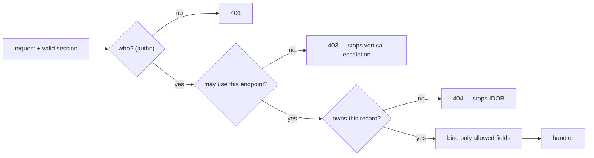
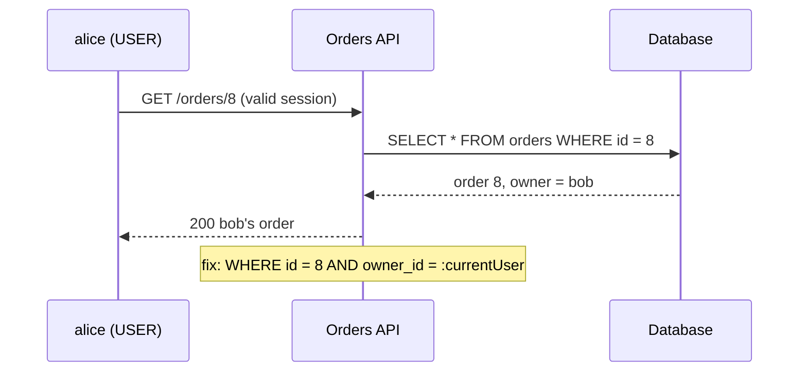

# Broken Access Control and IDOR

## The intuition

Logging in answers one question: **who is calling**. It says nothing about what
that caller is allowed to do. Broken access control is everything that goes wrong
in the gap between "this is alice" and "alice may do *this*". It has been number
one in the [OWASP Top 10](topic:owasp-top-ten) since 2021, and for a dull reason:
there is no library that fixes it for you. Every endpoint, every query, every
request body has to be checked against the business rules of *your* domain.

After [authentication](topic:authentication-flow) succeeds, the server still has to
answer three questions for every request:

| Question | Layer | When it is missing |
|---|---|---|
| May this caller use **this endpoint** at all? | function level | **vertical** escalation: a user reaches admin functions |
| May this caller touch **this record**, or see **these rows**? | object level | **IDOR** — **horizontal** escalation: a user reaches another user's data |
| May this caller set **these fields**? | property level | **mass assignment**: a user sets `role`, `price`, `ownerId` |

OWASP's API list names the same three: BFLA (Broken Function Level Authorization),
BOLA (Broken Object Level Authorization — the API name for IDOR), and BOPLA
(Broken Object Property Level Authorization).



## Horizontal escalation: IDOR

**IDOR** (Insecure Direct Object Reference) is the textbook case. The handler
takes an id from the request and loads the record by that id alone:

```java
@GetMapping("/orders/{id}")
OrderDto get(@PathVariable long id) {
    return toDto(orders.findById(id).orElseThrow());   // whose order? nobody asked
}
```

Alice owns order 7. She changes the URL to `/orders/8` and reads bob's. She has
the same role as bob — this is *horizontal* escalation, sideways to a peer's data.



The fix is to make ownership part of the lookup, so the "check" cannot be
forgotten in one handler and remembered in another:

```java
interface OrderRepository extends JpaRepository<Order, Long> {
    Optional<Order> findByIdAndOwnerId(long id, long ownerId);
    List<Order> findAllByOwnerId(long ownerId, Pageable page);
}

@GetMapping("/orders/{id}")
OrderDto get(@PathVariable long id, @AuthenticationPrincipal AppUser me) {
    return orders.findByIdAndOwnerId(id, me.id())
            .map(this::toDto)
            .orElseThrow(NotFoundException::new);       // 404, not 403
}
```

Key details interviewers look for:

- **The owner comes from the session or the verified token**, never from the
  request. `@AuthenticationPrincipal`, `SecurityContextHolder` — not
  `?userId=`, not a header, not a body field.
- **Writes and deletes need it as much as reads.** A common real bug: the GET
  handler was fixed after a pentest, PATCH and DELETE were not. The more damaging
  half stays open. Put the check in one place — a repository method that
  requires the owner, a domain service, or a policy bean used by
  `@PreAuthorize("@orderPolicy.canEdit(#id, authentication)")` — rather than
  copying an `if` into every controller.
- **Lists are IDOR without an id.** `GET /orders?ownerId=42` that trusts the
  parameter, or `GET /orders` that returns everything when the parameter is
  missing, leaks whole tables. The owner of a list query is the current user;
  if admins need other users' lists, that is a separate endpoint with a role
  check. Same for search, export, reports, GraphQL resolvers, nested resources
  (`/orders/8/items`) and bulk endpoints taking a list of ids.
- **Check the id you write, not only the id in the path.** If the handler checks
  `/orders/7` but then saves an entity whose `id` came from the JSON body, the
  write lands on order 8. The path id is the only id; the body must not carry
  one into the entity.
- **Ids of related records need the same check.** `POST /payments` with
  `{"orderId": 8, "cardId": 3}` has no id in the path, yet both fields point at
  records: the handler checks that the caller may create payments and then pays
  bob's order with someone else's saved card. Every reference in a body or query
  — `orderId`, `addressId`, `attachmentId`, `parentCommentId`, `invoiceIds[]` — is
  loaded through the same owner-scoped lookup as a path id:

  ```java
  Order order = orders.findByIdAndOwnerId(req.orderId(), me.id())
          .orElseThrow(NotFoundException::new);
  Card card = cards.findByIdAndOwnerId(req.cardId(), me.id())
          .orElseThrow(NotFoundException::new);
  ```

  The same goes for a child reached through its parent: `/orders/7/items/55`
  must check that item 55 belongs to order 7, not only that order 7 is yours.
- **Answer 404 for someone else's record.** A 403 confirms the record exists,
  so a caller can map valid ids. Querying by id *and* owner gives "not found" for
  both cases naturally. (403 is still right when existence is not secret, e.g. a
  role check on a known admin endpoint — see
  [API error handling](topic:api-error-handling).)
- **Multi-tenant systems** need the same check one level up: the tenant comes
  from the token, and every query is scoped by it — Hibernate filters, a
  tenant-aware repository base class, or PostgreSQL row-level security as a
  safety net.

### UUIDs are not access control

Switching sequential ids to random UUIDs makes *guessing* hard, so it slows
enumeration. It does nothing for a *known* id — and ids leak constantly: shared
links, logs, `Referer` headers, emails, screenshots, other API responses. A
leaked UUID opens the record exactly as a guessed number would. Use UUIDs if you
like (they also hide business volumes), but always as defense in depth on top of
the ownership check, never instead of it.

## Vertical escalation

Vertical escalation is a user reaching functions meant for a higher role. The
usual cause is that the role is enforced only by the UI: the "Admin" menu is
hidden, but the endpoint behind it checks nothing. The URL is in the JavaScript
bundle, so hiding a button protects nothing.

The role check belongs on the server, for every request:

```java
http.authorizeHttpRequests(auth -> auth
        .requestMatchers("/admin/**").hasRole("ADMIN")
        .anyRequest().authenticated());           // deny-by-default style

@PreAuthorize("hasRole('ADMIN')")
public byte[] exportAllOrders() { ... }
```

URL rules and method security complement each other: URL rules give a
deny-by-default backbone (see [endpoint security design](topic:endpoint-security-design)),
method-level `@PreAuthorize` keeps the rule next to the code it protects and
survives a new controller mapping the same service. Remember that
`@PreAuthorize` works through a [Spring AOP proxy](topic:spring-aop-proxy), so a
self-invocation inside the same bean skips it.

Other vertical paths worth naming: an HTTP method nobody restricted (the rule
covers `GET /admin/users` but not `DELETE`), an "internal" endpoint exposed
through the gateway, a role read from a client-controlled claim, and — the one
that surprises people — mass assignment.

## Mass assignment

Frameworks make it easy to bind a JSON body straight onto an entity. Then the
client controls every field the entity has, not only the ones the form shows:

```java
@PatchMapping("/users/me")
User update(@RequestBody User body, @AuthenticationPrincipal AppUser me) {
    body.setId(me.id());
    return users.save(body);        // {"displayName":"Al","role":"ADMIN"}
}
```

Alice adds `"role":"ADMIN"` and promotes herself — property-level breakage
turning into vertical escalation. On an order the same bug lets the client set
`price`, `status: "PAID"`, `ownerId`, or an `id` that redirects the save to
another record past an ownership check that ran on the path id.

The defense is an **explicit allowlist**: bind into a request DTO that contains
only what a client may set, and copy those fields onto the entity yourself.

```java
record UpdateProfileRequest(@Size(max = 50) String displayName) {}

@PatchMapping("/users/me")
ProfileDto update(@Valid @RequestBody UpdateProfileRequest req,
                  @AuthenticationPrincipal AppUser me) {
    User user = users.findById(me.id()).orElseThrow();
    user.setDisplayName(req.displayName());     // role is not even expressible
    return toDto(user);
}
```

Weaker alternatives and why: `@JsonIgnore` on sensitive entity fields is a
denylist — the next new field is exposed by default; `@InitBinder` with
`setAllowedFields` works for form binding but not for `@RequestBody`. Response
DTOs matter too: returning the entity leaks `passwordHash`, internal flags and
other users' data from lazy relations (the "excessive data exposure" half of
BOPLA). Different roles may need different request DTOs (a user edits `note`, an
admin may also edit `status`). See [PUT vs PATCH](topic:put-vs-patch) for how
partial updates complicate binding.

## How to test for it

Access control bugs are invisible to single-user tests: everything "works".

- **Two-user tests.** For every endpoint that takes an id, create the resource as
  user A and call it as user B: GET, PUT/PATCH, DELETE, sub-resources, lists,
  exports. Expect 404 (or 403), never 200.
- **Role matrix.** A table of endpoints × roles with the expected status, executed
  in integration tests (`@WithMockUser`, `MockMvc`). New endpoint without a row
  fails the build.
- **Unexpected fields.** Send `role`, `id`, `ownerId`, `price` in bodies and
  assert they are ignored.
- **Log and alert** on denials: a burst of 404s on sequential ids from one user is
  an enumeration attempt.

## 60-second interview answer

> Broken access control is the gap between authentication and authorization, and
> it is OWASP number one. Beyond "who are you", every request needs three server-side
> checks. Function level: may this role call this endpoint — missing it is vertical
> escalation, like a hidden admin button whose URL anyone can call; I enforce it
> with deny-by-default URL rules plus `@PreAuthorize`. Object level: does this record
> belong to the caller — missing it is IDOR, horizontal escalation; I make ownership
> part of the query, `findByIdAndOwnerId(id, currentUser)`, with the user taken from
> the security context, and I apply it to writes, deletes, lists, exports and nested
> resources, not just GET. Foreign records get 404 so I do not confirm they exist.
> Property level: which fields may the caller set — missing it is mass assignment,
> where a body with `"role":"ADMIN"` or a different `id` gets bound onto the entity;
> I bind into request DTOs with only editable fields. UUIDs help against enumeration
> but are not a check. And I test it with two users and a role matrix, because
> single-user tests never see these bugs.

## Production relevance

- Most real API breaches are BOLA: a mobile app's private API with numeric ids and
  no ownership check, scraped with a loop.
- The check must survive refactoring and new endpoints, so centralize it
  (repository methods requiring the owner, a policy service, row-level security as
  a backstop) instead of relying on reviewers to spot a missing `if`.
- Access control decisions belong on the server; the frontend may hide things for
  UX, but it is not a security boundary. The same goes for anything the client
  sends: ids, owner parameters, roles in a body, identity headers.
- Pair it with other defenses that assume the session is real:
  [CSRF](topic:csrf) protection stops another site from using alice's session,
  while access control stops alice herself.

## Common misconceptions

- **"All endpoints require a JWT, so we are secure."** That is authentication. A
  valid token for alice opening bob's order is exactly what IDOR is.
- **"We use UUIDs, so IDOR is impossible."** Unguessable is not unknowable; a leaked
  id works without an ownership check.
- **"The admin page is hidden for normal users."** The endpoint is not. Hiding UI is
  UX, not access control.
- **"We fixed IDOR on GET /orders/{id}."** And PATCH, DELETE, the list, the export,
  `/orders/{id}/items`, the bulk endpoint?
- **"The filter is in the query string, the frontend always sends the current
  user."** The server cannot know the parameter is honest. The owner comes from the
  session.
- **"403 is the correct answer for someone else's record."** It confirms existence;
  404 hides it. Use 403 where existence is not secret.
- **"`@JsonIgnore` on the role field prevents mass assignment."** It is a denylist on
  the entity; the safe pattern is an allowlist DTO.
- **"Ownership was checked, so the write is safe."** Check that the id you checked is
  the id you write — not one supplied again in the body.
