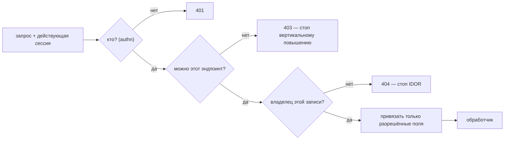
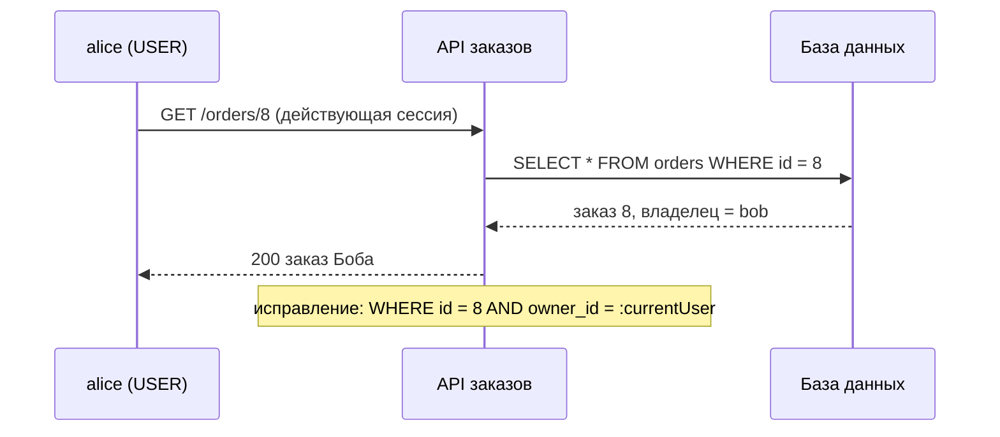

# Нарушенный контроль доступа и IDOR

## Интуиция

Вход в систему отвечает на один вопрос: **кто звонит**. О том, что этому
вызывающему разрешено делать, он не говорит ничего. Broken access control — это
всё, что ломается в промежутке между «это alice» и «alice можно сделать *вот это*».
С 2021 года это первое место в [OWASP Top 10](topic:owasp-top-ten), и причина
скучная: нет библиотеки, которая исправит это за вас. Каждый эндпоинт, каждый
запрос к базе, каждое тело запроса нужно проверять по бизнес-правилам *вашей*
предметной области.

После успешной [аутентификации](topic:authentication-flow) серверу для каждого
запроса нужно ответить ещё на три вопроса:

| Вопрос | Уровень | Если проверки нет |
|---|---|---|
| Может ли вызывающий вообще пользоваться **этим эндпоинтом**? | уровень функции | **вертикальное** повышение: пользователь добирается до функций администратора |
| Может ли он трогать **эту запись** или видеть **эти строки**? | уровень объекта | **IDOR** — **горизонтальное** повышение: пользователь добирается до чужих данных |
| Может ли он выставлять **эти поля**? | уровень свойств | **mass assignment**: пользователь выставляет `role`, `price`, `ownerId` |

В списке OWASP для API это те же три: BFLA (Broken Function Level Authorization),
BOLA (Broken Object Level Authorization — так IDOR называется в API) и BOPLA
(Broken Object Property Level Authorization).



## Горизонтальное повышение: IDOR

**IDOR** (Insecure Direct Object Reference, небезопасная прямая ссылка на объект) —
хрестоматийный случай. Обработчик берёт id из запроса и загружает запись только по
нему:

```java
@GetMapping("/orders/{id}")
OrderDto get(@PathVariable long id) {
    return toDto(orders.findById(id).orElseThrow());   // whose order? nobody asked
}
```

Заказ 7 принадлежит Алисе. Она меняет URL на `/orders/8` и читает заказ Боба. Роль
у неё та же, что у Боба, — это *горизонтальное* повышение, вбок, к данным равного.



Исправление — сделать владельца частью поиска, чтобы «проверку» нельзя было забыть
в одном обработчике и не забыть в другом:

```java
interface OrderRepository extends JpaRepository<Order, Long> {
    Optional<Order> findByIdAndOwnerId(long id, long ownerId);
    List<Order> findAllByOwnerId(long ownerId, Pageable page);
}

@GetMapping("/orders/{id}")
OrderDto get(@PathVariable long id, @AuthenticationPrincipal AppUser me) {
    return orders.findByIdAndOwnerId(id, me.id())
            .map(this::toDto)
            .orElseThrow(NotFoundException::new);       // 404, not 403
}
```

Детали, которых ждут на собеседовании:

- **Владелец берётся из сессии или проверенного токена**, а не из запроса.
  `@AuthenticationPrincipal`, `SecurityContextHolder` — а не `?userId=`, не
  заголовок и не поле тела.
- **Запись и удаление нуждаются в проверке не меньше чтения.** Частый реальный баг:
  после пентеста исправили GET, а PATCH и DELETE — нет. Более опасная половина
  остаётся открытой. Держите проверку в одном месте — метод репозитория, который
  требует владельца, доменный сервис или бин-политика для
  `@PreAuthorize("@orderPolicy.canEdit(#id, authentication)")`, — а не копируйте
  `if` в каждый контроллер.
- **Списки — это IDOR без id.** `GET /orders?ownerId=42`, доверяющий параметру, или
  `GET /orders`, который без параметра отдаёт всё, сливают целые таблицы. Владелец
  списка — текущий пользователь; если администратору нужны чужие списки, это
  отдельный эндпоинт с проверкой роли. То же относится к поиску, выгрузкам,
  отчётам, резолверам GraphQL, вложенным ресурсам (`/orders/8/items`) и пакетным
  эндпоинтам, принимающим список id.
- **Проверяйте тот id, в который пишете, а не только id из пути.** Если обработчик
  проверил `/orders/7`, а затем сохраняет сущность, чей `id` пришёл из JSON-тела,
  запись попадёт в заказ 8. Единственный id — id из пути; тело не должно приносить
  свой в сущность.
- **На чужую запись отвечайте 404.** 403 подтверждает, что запись существует, и
  вызывающий может составить карту действующих id. Запрос по id *и* владельцу
  естественно даёт «не найдено» в обоих случаях. (403 по-прежнему уместен, когда
  существование не секрет, например при проверке роли на известном админском
  эндпоинте, — см. [обработку ошибок API](topic:api-error-handling).)
- **В мультитенантных системах** та же проверка нужна уровнем выше: тенант берётся
  из токена, и каждый запрос ограничен им — фильтры Hibernate, базовый класс
  репозитория с учётом тенанта или row-level security в PostgreSQL как страховка.

### UUID — это не контроль доступа

Замена последовательных id на случайные UUID затрудняет *угадывание*, то есть
замедляет перебор. Против *известного* id она бессильна, а id утекают постоянно:
общие ссылки, логи, заголовок `Referer`, письма, скриншоты, ответы других API.
Утёкший UUID открывает запись так же, как угаданное число. Используйте UUID, если
хотите (они ещё и скрывают объёмы бизнеса), но как дополнительный слой поверх
проверки владельца, а не вместо неё.

## Вертикальное повышение

Вертикальное повышение — это когда пользователь добирается до функций более
высокой роли. Обычная причина — роль проверяется только в UI: меню «Админ»
скрыто, а эндпоинт за ним ничего не проверяет. URL лежит в JavaScript-бандле,
так что спрятанная кнопка ничего не защищает.

Проверка роли должна быть на сервере, для каждого запроса:

```java
http.authorizeHttpRequests(auth -> auth
        .requestMatchers("/admin/**").hasRole("ADMIN")
        .anyRequest().authenticated());           // deny-by-default style

@PreAuthorize("hasRole('ADMIN')")
public byte[] exportAllOrders() { ... }
```

Правила по URL и method security дополняют друг друга: правила по URL дают каркас
с запретом по умолчанию (см. [проектирование безопасности эндпоинтов](topic:endpoint-security-design)),
а `@PreAuthorize` на методе держит правило рядом с защищаемым кодом и переживает
появление нового контроллера, вызывающего тот же сервис. Помните, что
`@PreAuthorize` работает через [прокси Spring AOP](topic:spring-aop-proxy), так что
вызов изнутри того же бина его обходит.

Другие вертикальные пути, которые стоит назвать: HTTP-метод, который никто не
ограничил (правило покрывает `GET /admin/users`, но не `DELETE`), «внутренний»
эндпоинт, открытый через шлюз, роль, прочитанная из claim, который контролирует
клиент, и — то, что удивляет многих, — mass assignment.

## Mass assignment

Фреймворки позволяют легко привязать JSON-тело прямо к сущности. Тогда клиент
управляет каждым полем сущности, а не только теми, что показаны в форме:

```java
@PatchMapping("/users/me")
User update(@RequestBody User body, @AuthenticationPrincipal AppUser me) {
    body.setId(me.id());
    return users.save(body);        // {"displayName":"Al","role":"ADMIN"}
}
```

Алиса добавляет `"role":"ADMIN"` и повышает себя сама — поломка на уровне свойств
превращается в вертикальное повышение. В заказе тот же баг позволяет клиенту
выставить `price`, `status: "PAID"`, `ownerId` или `id`, перенаправляющий
сохранение в другую запись мимо проверки владельца, которая прошла по id из пути.

Защита — **явный список разрешённых полей**: привязывайте тело к DTO запроса, в
котором есть только то, что клиенту можно выставлять, и сами переносите эти поля в
сущность.

```java
record UpdateProfileRequest(@Size(max = 50) String displayName) {}

@PatchMapping("/users/me")
ProfileDto update(@Valid @RequestBody UpdateProfileRequest req,
                  @AuthenticationPrincipal AppUser me) {
    User user = users.findById(me.id()).orElseThrow();
    user.setDisplayName(req.displayName());     // role is not even expressible
    return toDto(user);
}
```

Более слабые альтернативы и почему: `@JsonIgnore` на чувствительных полях
сущности — это запрет по списку, и следующее новое поле открыто по умолчанию;
`@InitBinder` с `setAllowedFields` работает для привязки форм, но не для
`@RequestBody`. DTO ответа тоже важны: возврат сущности сливает `passwordHash`,
внутренние флаги и данные других пользователей из ленивых связей (половина BOPLA
про «избыточное раскрытие данных»). Разным ролям могут понадобиться разные DTO
запроса (пользователь меняет `note`, администратор ещё и `status`). Как частичные
обновления усложняют привязку, см. [PUT vs PATCH](topic:put-vs-patch).

## Как это тестировать

Баги контроля доступа невидимы для тестов с одним пользователем: всё «работает».

- **Тесты с двумя пользователями.** Для каждого эндпоинта, принимающего id,
  создайте ресурс от пользователя A и вызовите его от B: GET, PUT/PATCH, DELETE,
  вложенные ресурсы, списки, выгрузки. Ожидайте 404 (или 403), но никогда 200.
- **Матрица ролей.** Таблица «эндпоинты × роли» с ожидаемым статусом, выполняемая в
  интеграционных тестах (`@WithMockUser`, `MockMvc`). Новый эндпоинт без строки в
  таблице ломает сборку.
- **Неожиданные поля.** Отправляйте в телах `role`, `id`, `ownerId`, `price` и
  проверяйте, что они игнорируются.
- **Логируйте отказы и настройте оповещения**: всплеск 404 по последовательным id от
  одного пользователя — это попытка перебора.

## Ответ на собеседовании за 60 секунд

> Broken access control — это разрыв между аутентификацией и авторизацией, и это
> первое место в OWASP. Помимо «кто вы», каждый запрос требует трёх проверок на
> сервере. Уровень функции: может ли эта роль вызывать этот эндпоинт — без проверки
> это вертикальное повышение, как скрытая кнопка администратора, чей URL может
> вызвать любой; я обеспечиваю это правилами по URL с запретом по умолчанию плюс
> `@PreAuthorize`. Уровень объекта: принадлежит ли запись вызывающему — без проверки
> это IDOR, горизонтальное повышение; я делаю владельца частью запроса,
> `findByIdAndOwnerId(id, currentUser)`, где пользователь взят из security context,
> и применяю это к записи, удалению, спискам, выгрузкам и вложенным ресурсам, а не
> только к GET. На чужие записи — 404, чтобы не подтверждать их существование.
> Уровень свойств: какие поля может выставлять вызывающий — без проверки это mass
> assignment, когда тело с `"role":"ADMIN"` или чужим `id` привязывается к сущности;
> я привязываю тела к DTO запроса только с редактируемыми полями. UUID помогают
> против перебора, но проверкой не являются. И тестирую это двумя пользователями и
> матрицей ролей, потому что тесты с одним пользователем таких багов не видят.

## Значение в продакшене

- Большинство реальных утечек через API — это BOLA: приватное API мобильного
  приложения с числовыми id без проверки владельца, выкачанное циклом.
- Проверка должна переживать рефакторинг и новые эндпоинты, поэтому её
  централизуют (методы репозитория, требующие владельца, сервис политик,
  row-level security как страховка), а не надеются, что ревьюер заметит
  пропущенный `if`.
- Решения о доступе принимаются на сервере; фронтенд может что-то скрывать ради
  удобства, но границей безопасности не является. То же касается всего, что
  присылает клиент: id, параметров владельца, ролей в теле, заголовков с
  идентичностью.
- Сочетайте это с другими защитами, исходящими из того, что сессия настоящая:
  защита от [CSRF](topic:csrf) не даёт чужому сайту воспользоваться сессией Алисы,
  а контроль доступа останавливает саму Алису.

## Частые заблуждения

- **«Все эндпоинты требуют JWT, значит, мы защищены».** Это аутентификация.
  Действующий токен Алисы, открывающий заказ Боба, — это и есть IDOR.
- **«У нас UUID, значит, IDOR невозможен».** Неугадываемый не значит неизвестный;
  утёкший id без проверки владельца работает.
- **«Админская страница скрыта от обычных пользователей».** Эндпоинт — нет. Скрыть UI —
  это UX, а не контроль доступа.
- **«Мы исправили IDOR в GET /orders/{id}».** А PATCH, DELETE, список, выгрузку,
  `/orders/{id}/items`, пакетный эндпоинт?
- **«Фильтр в query string, фронтенд всегда присылает текущего пользователя».**
  Сервер не может знать, честен ли параметр. Владелец берётся из сессии.
- **«На чужую запись правильный ответ — 403».** Он подтверждает существование; 404
  его скрывает. 403 уместен там, где существование не секрет.
- **«`@JsonIgnore` на поле роли предотвращает mass assignment».** Это запрет по
  списку на сущности; безопасный шаблон — DTO со списком разрешённых полей.
- **«Владелец проверен, значит, запись безопасна».** Убедитесь, что проверенный id —
  это тот id, в который вы пишете, а не тот, что ещё раз пришёл в теле.
