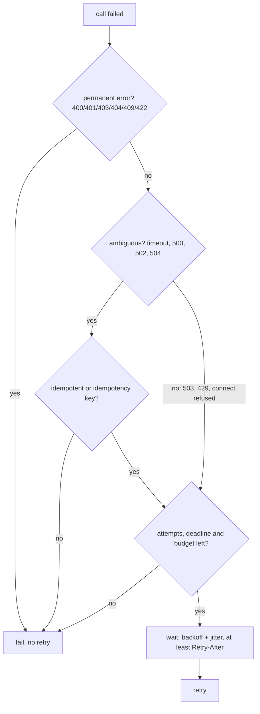
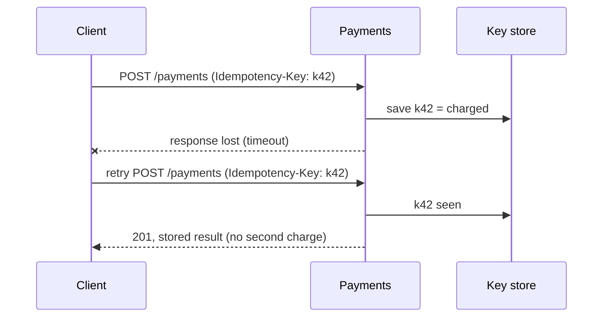

# Retrying Failed Calls Safely

A retry turns a short, transient failure (a dropped connection, a restarting
pod, a briefly overloaded service) into a success the user never notices.
Done carelessly, it also turns a struggling service into a dead one, charges
a card twice, or makes one user request into dozens of calls to a database that
is already down. A safe retry policy answers four questions:

1. **When** to try again: backoff, with jitter.
2. **What** to retry: transient errors only, and ambiguous ones only when the
   operation is idempotent.
3. **How much**: a cap on attempts, the request deadline, a retry budget.
4. **Where**: at one layer of the stack, not at every one.

Retries are one tool in a larger resilience kit. They need
[timeouts and circuit breakers](topic:service-timeouts-fallbacks) next to them,
and they depend on [idempotency](topic:http-idempotency) to be safe at all.



## 1. Backoff: wait longer each time

Retrying immediately is the worst option. If the service failed because it is
overloaded, an instant retry adds load exactly when it has least capacity. With
**exponential backoff** each retry waits longer than the previous one:

```
delay(k) = min(maxDelay, baseDelay * multiplier^k)      // k = 0 for the first retry
100 ms, 200 ms, 400 ms, 800 ms, ... capped at maxDelay
```

The **cap** (`maxDelay`) matters: without it the fifth or sixth retry waits for
minutes, longer than anyone is still waiting for the answer.

## 2. Jitter: do not retry in lockstep

Backoff alone has a subtle problem. When a service blips, *every* client fails
at the same moment. If they all use the same backoff schedule, they all retry at
the same moment too: 1000 clients fail at t=0, then 1000 retries land at
t=100 ms, 1000 more at t=300 ms. This is the **thundering herd**. The service
recovers, gets flattened again by a synchronized wave, and never gets out of it.

**Jitter** randomizes each wait so that clients spread out:

| Variant | Wait | Notes |
|---|---|---|
| no jitter | `d` | synchronized waves |
| full jitter | `random(0, d)` | best spread, the usual default |
| equal jitter | `d/2 + random(0, d/2)` | guarantees some minimum wait |

Backoff decides *how long on average*; jitter makes sure the waits are *not
identical*. You need both. The `jitter-herd` example shows 20 clients: without
jitter all 20 retries hit the same 100 ms window, with full jitter the peak
drops to a few.

## 3. Which errors to retry

Ask one question about every failure: **will the same request succeed if sent
again later, and is it safe to send it again?**

| Group | Examples | Retry? |
|---|---|---|
| Transient, not processed | `503 Service Unavailable`, `429 Too Many Requests`, connection refused, DNS failure | yes |
| Ambiguous, maybe processed | read timeout, `500`, `502`, `504`, connection reset mid-response | only if the operation is idempotent |
| Permanent | `400`, `401`, `403`, `404`, `409`, `422`, validation or business errors | never |

- **Permanent errors** fail the same way every time. Retrying a `400` just
  produces three `400`s and three times the log noise.
- **429 and 503** usually mean "not now". If the response carries
  `Retry-After`, wait **at least** that long; the server knows its own recovery
  time better than your backoff formula does.
- **Connection refused** means the request never reached the server, so it is
  safe to retry even for a non-idempotent call.
- A **timeout** is the dangerous one: you do not know whether the server did the
  work. The request may have been processed and only the response lost.

In Java code this maps to exceptions too: `ConnectException` is safe,
`SocketTimeoutException` or `HttpTimeoutException` is ambiguous, an
`IllegalArgumentException` or a validation error from your own code is
permanent. Do not retry on a blanket `Exception`.

## 4. Ambiguous failures need idempotency

`GET`, `PUT` and `DELETE` are idempotent by definition: repeating them leaves
the system in the same state. `POST` and `PATCH` are not. After a timeout on
`POST /payments` a retry may charge the card twice.

The fix is an **idempotency key**: the client generates a unique key per logical
operation (`order-42-payment`) and sends it with every attempt. The server stores
the key with the result and, on a repeat, returns the stored result instead of
doing the work again. That turns any operation into one that is safe to retry.
See [Idempotency](topic:http-idempotency) and
[Registering Sales over an Unreliable Connection](topic:sales-api-unreliable-connection).



## 5. How much: attempts, deadline, budget

- **Max attempts.** Typically 3 total (one call and two retries). More rarely
  helps: if three spaced attempts failed, the problem is not transient.
- **Request deadline.** Retries must fit in the caller's time budget. If the
  page must answer in 500 ms, stop when the next wait would cross it rather than
  returning a success nobody is waiting for. Each attempt also needs its own
  timeout, or one hanging attempt eats the whole deadline.
- **Retry budget.** A per-client limit on retries, e.g. "retries may be at most
  10% of requests" (a token bucket). When the dependency is really down, every
  call fails and every call wants to retry; the budget makes the client fail fast
  instead of tripling the load. A
  [circuit breaker](topic:service-timeouts-fallbacks) goes further and stops even
  the first attempt while the dependency is open-circuited.

## 6. Where in the stack

Retries multiply across layers. If the gateway, the orders service and the
inventory service each retry 3 times, one user request becomes `3 × 3 × 3 = 27`
calls to the database that is already failing. That is **retry amplification**,
and it is how a small outage becomes a big one.


Rules of thumb:

- **Retry at one layer**, usually the one closest to the failing dependency,
  because it knows best which errors are transient there. Layers above
  propagate the failure (fast) instead of retrying again.
- If an upstream layer must retry (for example the mobile client over a flaky
  network), the inner services should not, or should signal "already retried,
  do not retry" (gRPC and Envoy support this via retry headers and policies).
- Do not retry inside a database transaction that holds locks; retry the whole
  unit of work from outside.
- Retrying a **message consumer** is a different tool: redelivery with a
  dead-letter queue, plus [inbox-style deduplication](topic:inbox-pattern).

## In Java

Libraries such as Resilience4j `Retry` and Spring Retry `@Retryable` implement
all of this declaratively: `maxAttempts`, an exponential `IntervalFunction`
with randomization (jitter), `retryExceptions` / `ignoreExceptions` (or
`retryOnResult`) to pick the error classes. Typical order of decorators is
`Retry(CircuitBreaker(TimeLimiter(call)))`: each attempt has its own timeout,
and the breaker sees each attempt. Note that `@Retryable` works through a Spring
[proxy](topic:spring-aop-proxy), so a self-invoked method is not retried.

## 60-second interview answer

> I retry only failures that are transient: 503, 429, connection refused. For
> ambiguous ones such as a timeout or a 502/504 I retry only if the operation is
> idempotent, or made idempotent by an idempotency key, because the server may
> already have done the work. Permanent errors like 400, 404 or 409 are never
> retried. Waits use exponential backoff with a cap, plus jitter so that clients
> that failed together do not retry together and flatten the service again; a
> `Retry-After` header overrides my backoff. Retries are bounded three ways: a
> small max attempts, the request deadline, and a retry budget, with a circuit
> breaker in front for real outages. And I retry at exactly one layer, the one
> nearest the dependency, because retries at every layer multiply: 3 at three
> layers is 27 calls to a database that is already down.

## Common misconceptions

- **"More retries means more reliability."** Past two or three, retries mostly
  add load to a service that is already failing.
- **"Backoff is enough."** Without jitter, clients that failed together retry
  together.
- **"Retry on any exception."** Retrying a `400` or a validation error never
  helps, and retrying a timed-out `POST` can duplicate the operation.
- **"A timeout means the server did nothing."** It means *you* stopped waiting.
  The work may be complete.
- **"Every service should protect itself with retries."** Retries at every layer
  multiply into an outage-amplifier.
- **"Retries replace a circuit breaker."** Retries handle blips; a breaker
  handles outages by not calling at all.
