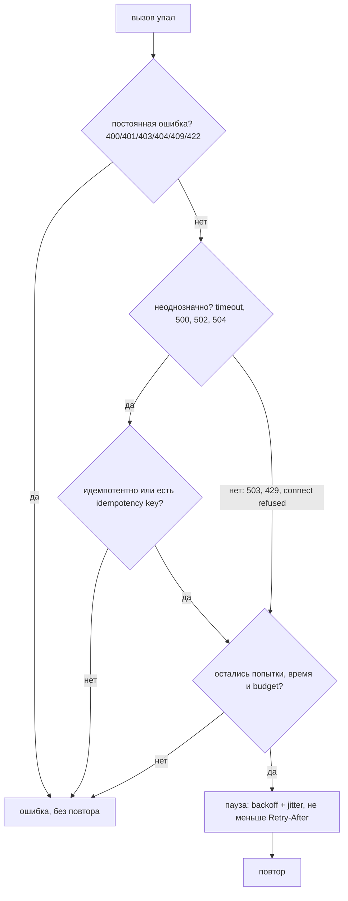
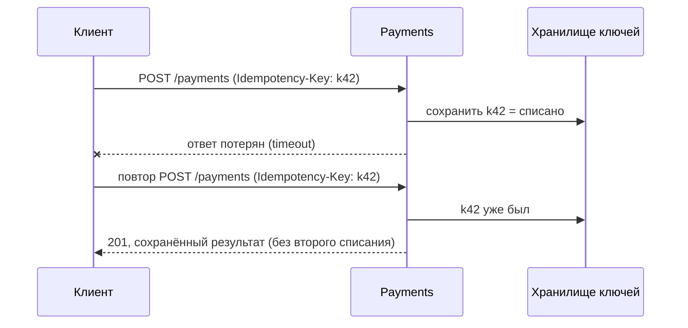

# Безопасные повторы неудачных вызовов

Retry превращает короткий временный сбой (оборванное соединение, перезапуск
пода, кратковременная перегрузка сервиса) в успех, которого пользователь даже не
заметит. Но небрежный retry превращает с трудом работающий сервис в мёртвый,
списывает деньги с карты дважды или делает из одного запроса пользователя
десятки вызовов к базе, которая и так лежит. Безопасная политика повторов
отвечает на четыре вопроса:

1. **Когда** пробовать снова: backoff, с jitter.
2. **Что** повторять: только временные ошибки, а неоднозначные — только если
   операция идемпотентна.
3. **Сколько**: лимит попыток, deadline запроса, retry budget.
4. **Где**: на одном уровне стека, а не на каждом.

Retry — один инструмент из большого набора устойчивости. Рядом с ним нужны
[timeouts и circuit breakers](topic:service-timeouts-fallbacks), а безопасен он
вообще только благодаря [идемпотентности](topic:http-idempotency).



## 1. Backoff: каждый раз ждать дольше

Повторять сразу — худший вариант. Если сервис упал из-за перегрузки, мгновенный
повтор добавляет нагрузку именно тогда, когда ресурсов меньше всего. При
**exponential backoff** каждая следующая пауза длиннее предыдущей:

```
delay(k) = min(maxDelay, baseDelay * multiplier^k)      // k = 0 для первого повтора
100 ms, 200 ms, 400 ms, 800 ms, ... не больше maxDelay
```

**Потолок** (`maxDelay`) важен: без него пятый-шестой повтор ждёт минуты —
дольше, чем кто-либо ещё ждёт ответа.

## 2. Jitter: не повторять в ногу

У одного backoff есть тонкая проблема. Когда сервис моргнул, падают *все*
клиенты в один и тот же момент. Если у всех одинаковое расписание backoff, то и
повторяют они все в один момент: 1000 клиентов упали в t=0, затем 1000 повторов
приходят в t=100 ms, ещё 1000 — в t=300 ms. Это **thundering herd** (стадо).
Сервис восстанавливается, его снова накрывает синхронной волной, и он никак не
может выбраться.

**Jitter** делает каждую паузу случайной, и клиенты расходятся во времени:

| Вариант | Пауза | Заметки |
|---|---|---|
| без jitter | `d` | синхронные волны |
| full jitter | `random(0, d)` | лучший разброс, обычный выбор по умолчанию |
| equal jitter | `d/2 + random(0, d/2)` | гарантирует минимальную паузу |

Backoff решает, *сколько ждать в среднем*; jitter гарантирует, что паузы *не
одинаковые*. Нужны оба. Пример `jitter-herd` показывает 20 клиентов: без jitter
все 20 повторов попадают в одно окно 100 ms, с full jitter пик падает до
нескольких.

## 3. Какие ошибки повторять

Про каждый сбой задайте один вопрос: **пройдёт ли тот же запрос, если отправить
его позже, и безопасно ли отправлять его ещё раз?**

| Группа | Примеры | Повторять? |
|---|---|---|
| Временные, не обработаны | `503 Service Unavailable`, `429 Too Many Requests`, connection refused, сбой DNS | да |
| Неоднозначные, возможно обработаны | read timeout, `500`, `502`, `504`, обрыв соединения посреди ответа | только если операция идемпотентна |
| Постоянные | `400`, `401`, `403`, `404`, `409`, `422`, ошибки валидации и бизнес-правил | никогда |

- **Постоянные ошибки** каждый раз падают одинаково. Повтор `400` даёт просто
  три `400` и втрое больше шума в логах.
- **429 и 503** обычно значат «не сейчас». Если в ответе есть `Retry-After`,
  ждите **не меньше** указанного: сервер знает время своего восстановления лучше,
  чем ваша формула backoff.
- **Connection refused** значит, что запрос не дошёл до сервера, поэтому его
  можно повторять даже для неидемпотентного вызова.
- Опаснее всего **timeout**: вы не знаете, сделал ли сервер работу. Запрос мог
  быть обработан, а потерялся только ответ.

В Java-коде то же самое касается исключений: `ConnectException` — безопасно,
`SocketTimeoutException` или `HttpTimeoutException` — неоднозначно,
`IllegalArgumentException` или ошибка валидации из вашего кода — постоянная
ошибка. Не повторяйте на любое `Exception` подряд.

## 4. Неоднозначным сбоям нужна идемпотентность

`GET`, `PUT` и `DELETE` идемпотентны по определению: повтор оставляет систему в
том же состоянии. `POST` и `PATCH` — нет. После timeout на `POST /payments`
повтор может списать деньги дважды.

Решение — **idempotency key**: клиент генерирует уникальный ключ на одну
логическую операцию (`order-42-payment`) и отправляет его с каждой попыткой.
Сервер сохраняет ключ вместе с результатом и на повтор возвращает сохранённый
результат, а не выполняет работу заново. Так любую операцию можно безопасно
повторять. См. [Идемпотентность](topic:http-idempotency) и
[Регистрация продаж при нестабильном соединении](topic:sales-api-unreliable-connection).



## 5. Сколько: попытки, deadline, budget

- **Максимум попыток.** Обычно 3 всего (один вызов и два повтора). Больше редко
  помогает: если три разнесённые во времени попытки упали, проблема не временная.
- **Deadline запроса.** Повторы должны укладываться во время вызывающего. Если
  страница должна ответить за 500 ms, остановитесь, когда следующая пауза его
  пересечёт, а не возвращайте успех, которого уже никто не ждёт. И у каждой
  попытки нужен свой timeout, иначе одна зависшая попытка съест весь deadline.
- **Retry budget.** Лимит повторов на клиента, например «повторы — не больше 10%
  запросов» (token bucket). Когда зависимость действительно лежит, падает каждый
  вызов и каждый хочет повтора; budget заставляет клиента быстро отказывать, а не
  утраивать нагрузку. [Circuit breaker](topic:service-timeouts-fallbacks) идёт
  дальше и не делает даже первую попытку, пока цепь разомкнута.

## 6. На каком уровне стека

Повторы перемножаются по уровням. Если gateway, сервис orders и сервис inventory
каждый повторяют по 3 раза, один запрос пользователя превращается в
`3 × 3 × 3 = 27` вызовов к базе, которая и так падает. Это **retry
amplification** — именно так небольшой сбой становится большим.


Практические правила:

- **Повторяйте на одном уровне** — обычно ближайшем к упавшей зависимости: он
  лучше всех знает, какие ошибки там временные. Уровни выше передают ошибку
  дальше (быстро), а не повторяют ещё раз.
- Если повторять должен внешний уровень (например, мобильный клиент в плохой
  сети), внутренние сервисы не повторяют или сигнализируют «уже повторено, не
  повторяй» (gRPC и Envoy поддерживают это через retry-заголовки и политики).
- Не повторяйте внутри транзакции базы данных, держащей блокировки; повторяйте
  всю единицу работы снаружи.
- Повтор для **потребителя сообщений** — другой инструмент: redelivery с
  dead-letter queue плюс [дедупликация в стиле inbox](topic:inbox-pattern).

## В Java

Библиотеки вроде Resilience4j `Retry` и Spring Retry `@Retryable` реализуют всё
это декларативно: `maxAttempts`, экспоненциальная `IntervalFunction` с
рандомизацией (jitter), `retryExceptions` / `ignoreExceptions` (или
`retryOnResult`) для выбора классов ошибок. Типичный порядок декораторов —
`Retry(CircuitBreaker(TimeLimiter(call)))`: у каждой попытки свой timeout, и
breaker видит каждую попытку. Учтите, что `@Retryable` работает через Spring
[proxy](topic:spring-aop-proxy), поэтому вызов метода изнутри того же бина не
повторяется.

## Ответ на собеседовании за 60 секунд

> Я повторяю только временные сбои: 503, 429, connection refused. Неоднозначные —
> timeout или 502/504 — повторяю, только если операция идемпотентна или сделана
> идемпотентной через idempotency key, потому что сервер мог уже выполнить
> работу. Постоянные ошибки вроде 400, 404 или 409 не повторяются никогда.
> Паузы — exponential backoff с потолком плюс jitter, чтобы клиенты, упавшие
> вместе, не повторяли вместе и снова не положили сервис; заголовок `Retry-After`
> важнее моего backoff. Повторы ограничены тремя способами: небольшим числом
> попыток, deadline запроса и retry budget, а на случай настоящего сбоя перед
> ними стоит circuit breaker. И повторяю я ровно на одном уровне — ближайшем к
> зависимости, потому что повторы на каждом уровне перемножаются: 3 на трёх
> уровнях — это 27 вызовов к базе, которая и так лежит.

## Частые заблуждения

- **«Больше повторов — выше надёжность».** После двух-трёх повторы в основном
  добавляют нагрузку на и так падающий сервис.
- **«Хватит одного backoff».** Без jitter клиенты, упавшие вместе, повторяют
  вместе.
- **«Повторять на любое исключение».** Повтор `400` или ошибки валидации никогда
  не помогает, а повтор `POST` после timeout может задвоить операцию.
- **«Timeout значит, что сервер ничего не сделал».** Он значит, что *вы*
  перестали ждать. Работа могла быть выполнена.
- **«Каждый сервис должен защищаться своими повторами».** Повторы на каждом
  уровне перемножаются и раздувают сбой.
- **«Повторы заменяют circuit breaker».** Повторы лечат кратковременные сбои;
  breaker справляется с настоящим отказом, вообще не делая вызов.
